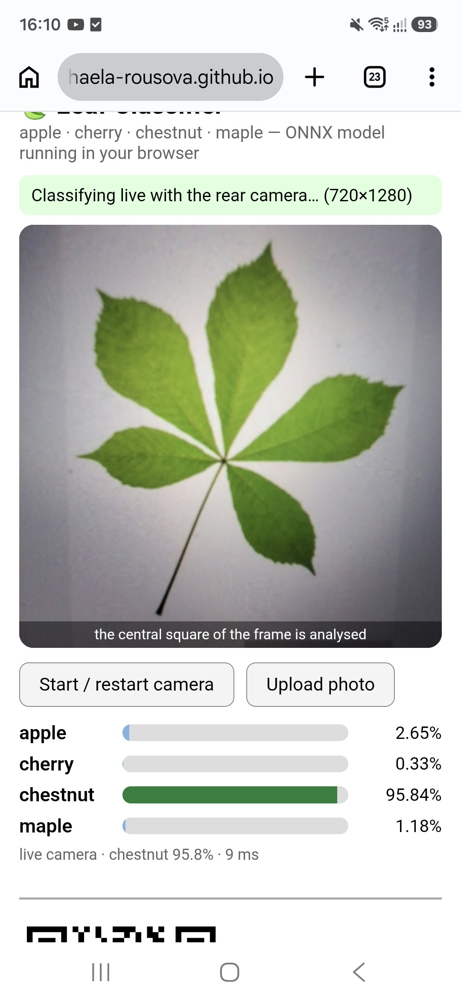
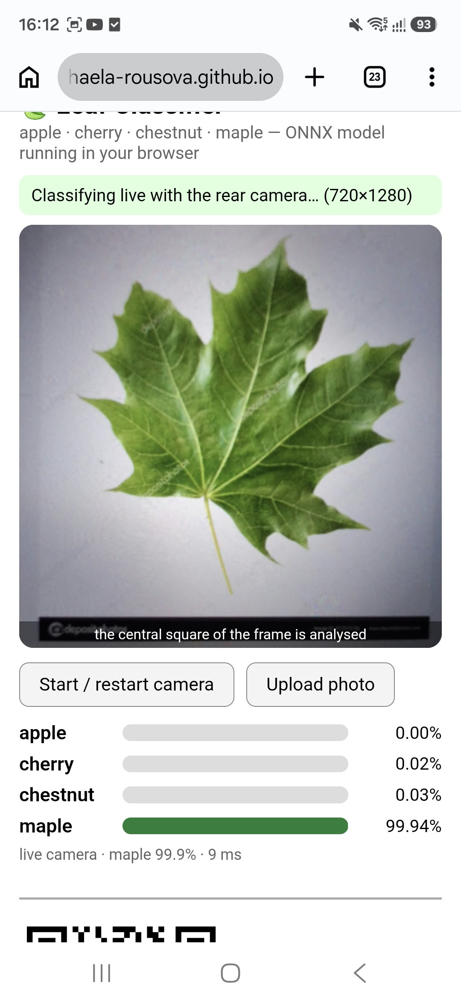
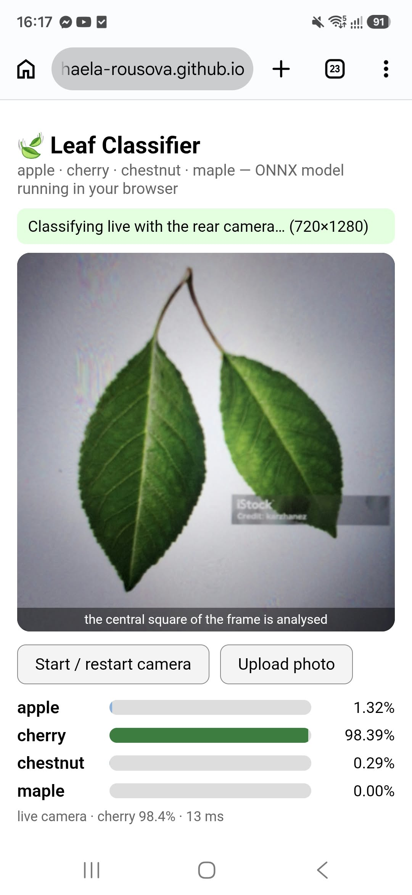
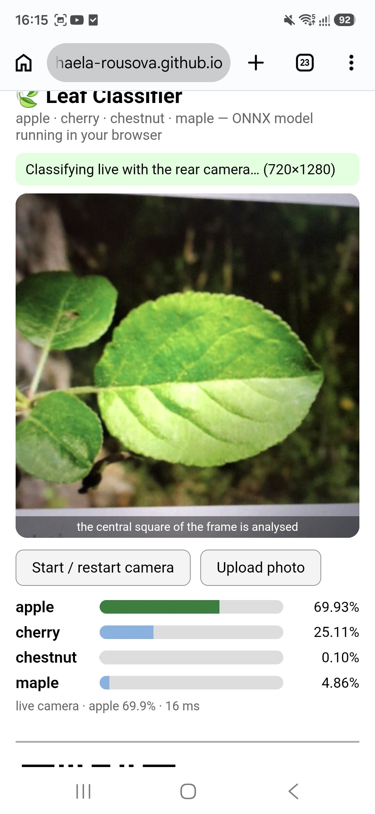

# Task 2 Review

Page URL: https://michaela-rousova.github.io/mlr-ex08/

## 1. Live classification on phone

The real leaves I took from the lab wilted before the weekend, so I opened photos of leaves from Google Images on my tablet and pointed my phone camera at the tablet screen. You can see stock photo watermarks on cherry and maple screenshots because of this. The rear camera ran at 720x1280 resolution and one prediction took around 9 to 16 ms.

Results from my screenshots:
chestnut.jpg: chestnut 95.84%, apple 2.65%, maple 1.18%, cherry 0.33% (9 ms)
maple.jpg: maple 99.94%, chestnut 0.03%, cherry 0.02%, apple 0.00% (9 ms)
cherry.jpg: cherry 98.39%, apple 1.32%, chestnut 0.29%, maple 0.00% (13 ms)
apple.jpg: apple 69.93%, cherry 25.11%, maple 4.86%, chestnut 0.10% (16 ms)

Chestnut, maple and cherry had light backgrounds and got over 95%. The apple photo had a dark forest background with other leaves and glare from the tablet screen, so the model was less sure and gave 69.93% for apple and 25.11% for cherry. Also the numbers jump a bit in live mode when I move my hand.

What was fixed: I did not have to fix the code because the agent already set ort.env.wasm.numThreads = 1 on lines 75-76 for mobile browsers on GitHub Pages and added playsinline on line 42 for the video tag.

## 2. Check image verification

I uploaded check_image.jpg from the repository to the web page and compared the output with check_expected.json from the notebook:

apple: expected 0.983353 (98.34%), web page showed 98.34%
cherry: expected 0.016628 (1.66%), web page showed 1.66%
chestnut: expected 0.000004 (0.00%), web page showed 0.00%
maple: expected 0.000015 (0.00%), web page showed 0.00%

The values match to three decimal places (the selftest mode on lines 247-263 gives max diff 1.25e-6).

What was fixed: At first I sent check_image.jpg to my phone over Messenger and uploaded that file. Messenger compressed the image and the result changed to 91.41% apple and 8.58% cherry. When I used the original uncompressed check_image.jpg directly from the repo folder, the numbers matched 98.34% and 1.66% as expected.

## 3. Preprocessing in index.html vs notebook transform

I read index.html and checked where the image preprocessing happens:
- Lines 82-85: loading input_size (96), mean and std from model_info.json.
- Lines 106-111: inside preprocessToTensor, it takes the smaller side s = Math.min(sw, sh) and offsets sx, sy to crop the center square. Then pctx.drawImage resizes it onto a hidden 96x96 canvas (with imageSmoothingQuality set to high) and getImageData reads the RGBA pixel array.
- Lines 112-119: a for loop goes through all 96*96 pixels, divides R, G, B values by 255, subtracts MEAN and divides by STD. It saves them into a Float32Array in CHW order (first all R pixels at index i, then G at HW + i, then B at 2*HW + i) and creates a 1x3x96x96 tensor.
- Lines 122-136: softmax function converts raw logits from session.run into probabilities.

Comparison with the notebook: In the notebook, transform only runs ToTensor() and Normalize(MEAN, STD) because the dataset images and check_image.jpg are already 96x96. In the browser, check_image.jpg is also 96x96 so canvas drawImage does not resize it and the output is almost identical. For camera frames (720x1280) or bigger uploaded photos, the browser resizes them in HTML canvas, which can give slightly different pixel values than PIL resize in Python.

What was fixed: Nothing was changed in index.html because the math and channel order match the notebook and check_image.jpg gave the right probabilities.

## 4. Privacy and network check

I checked the code in index.html to be sure no photos leave the phone:
- Camera video (getUserMedia on lines 172-183) and uploaded photos (lines 214-243) only go to the local canvas and local WebAssembly session. There are no POST requests or external API calls with image data.
- External URLs loaded by the page are only two GET scripts from jsDelivr CDN: qrcode-generator on line 66 and onnxruntime-web on lines 68 and 77.
- The QR code is generated locally in the browser into SVG on lines 270-274, so the page URL is not sent to any external QR service.
- Other fetch calls only load local files from my repository (model_info.json, leaf_model.onnx, and check files in selftest mode).

What was fixed: Nothing needed fixing, everything already ran locally in the browser.
